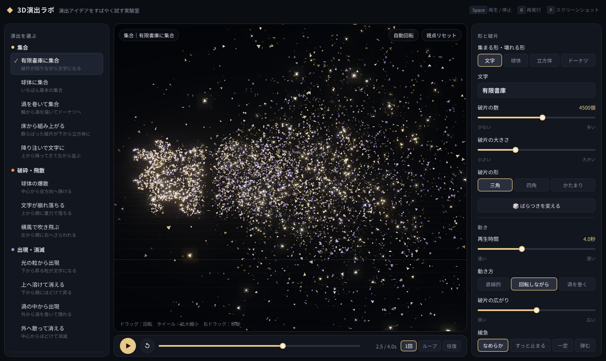
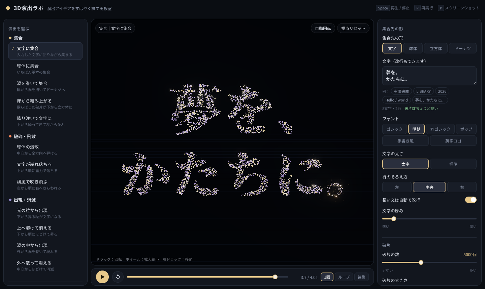
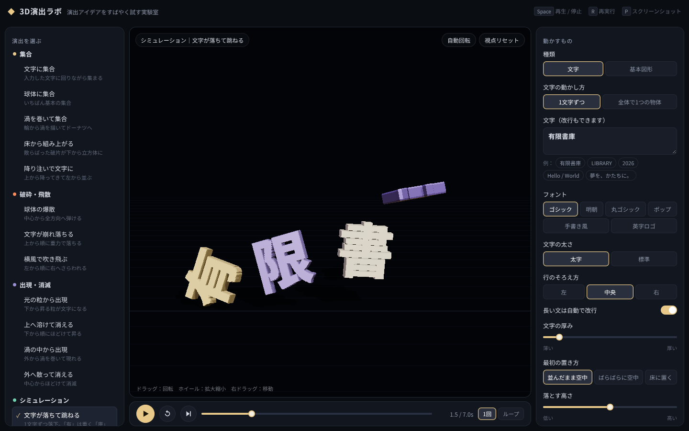

# 3D-Effect-Lab（3D演出ラボ）

Blenderで本格的に作る前に、「こういう動き・雰囲気にしたい」という演出アイデアを、ブラウザ上の簡単な3Dアニメーションですばやく試すためのWebアプリです。ビルド不要の静的HTML/JavaScriptだけで動きます。



## 現在の機能

### 演出（タイムライン型）
- **集合**：散らばった破片が文字や図形に集まる（散らばり方：空間全体／床／輪／上から降る）
- **破砕・飛散**：形が砕けて飛び散る（方向・速さ・重力・最後に消える）
- **出現・消滅**：光の粒とともに現れる／消える（粒子の流れ：上へ／外へ／その場）
- 集合先の形：**自由入力の文字**（日本語可・最大120文字、自動改行、6種のフォント、太さ・行揃え・厚み）／球体／立方体／ドーナツ
- 破片の数（200〜12000）・大きさ・形、再生時間、動き方、緩急、動き出す順番、時間差などをスライダーとボタンで調整
- 見た目：配色6種、背景3種、光の強さ、光の粒、床のグリッド
- 再生バー：再生・停止・再実行・シーク、1回／ループ／往復



### シミュレーション（物理演算）
- 文字や図形を立体として扱い、重力・衝突・反発・摩擦・空気抵抗で動かす（1/60秒の固定ステップで再現性あり）
- 動かすもの：文字（1文字ずつ／全体で1つ、文字の形で衝突判定）／立方体・球・円柱
- 引力・反発力：指定位置へ整列／一点に引き寄せる／中心から反発
- 環境：床、壁、障害物（箱・柱・斜面を最大8個）
- 一時停止・初期状態へリセット・コマ送り・スロー再生
- サンプル7種（文字が落ちて跳ねる、空中に整列、斜面を転がる など）



### 保存・Blender連携
- スクリーンショット（PNG）、設定・メモ・カメラ位置のJSON保存／読み込み（ドラッグ＆ドロップ可）
- Blenderで組み立てるときのヒント表示
- **⇪ Blenderへ出力**：シミュレーションの動きをフレームごとのJSON（30/60/24fps）に記録し、`app/blender/lab_to_blender.py` でキーフレーム付きオブジェクトとしてBlenderに再現（検証結果は `blender-check/`）

## 使用技術
- HTML / CSS / JavaScript（ビルドなし・フレームワークなし）
- [Three.js](https://threejs.org/) r160（3D描画、CDN: jsDelivr）
- [Rapier](https://rapier.rs/)（`@dimforge/rapier3d-compat` 0.14.0、物理演算、CDN: jsDelivr。シミュレーションを開いたときだけ読み込み）
- Google Fonts（Noto Sans JP / Noto Serif JP / M PLUS Rounded 1c / Dela Gothic One / Yomogi / Bebas Neue）
- Python（Blender の bpy）：Blenderへの読み込み・検証スクリプト

## 起動方法

### いちばん簡単な方法
`app/index.html` をダブルクリックして Chrome / Edge などで開きます。インストールやビルドは不要です。
Three.js・Rapier・フォントをインターネットから読み込むため、**ネット接続が必要**です。

### ローカルサーバーで開く（任意）
```sh
cd app
python -m http.server 8000
```
ブラウザで <http://localhost:8000> を開きます。

### GitHub Pages で開く
`app/` フォルダだけを GitHub Pages に自動公開しています（README や `blender-check/` は公開しません）。

- **公開URL**：`https://limitedlibrary.github.io/3D-Effect-Lab/`（予定。初回デプロイ後に Actions の結果で確定させます）
- **更新タイミング**：`main` に push（Pull Request のマージを含む）すると、`.github/workflows/deploy-pages.yml` が動いて1〜2分で反映されます。Actions 画面の「Deploy app to GitHub Pages」→「Run workflow」で手動実行もできます。反映後に古い画面が出るときは強制再読み込み（Ctrl+Shift+R / Cmd+Shift+R）してください。
- **最初の設定（1回だけ）**：リポジトリの **Settings → Pages → Build and deployment → Source** を「**GitHub Actions**」にします。GitHub Free ではリポジトリが Public でないと Pages を使えません。
- **うまく表示されないとき**：
  - **Actions** タブで「Deploy app to GitHub Pages」の実行が失敗していないか
  - **Settings → Pages** に公開URLと最終デプロイが表示されているか
  - **Settings → Environments → github-pages** のデプロイ履歴
  - ブラウザの開発者ツール（F12）の Console に Three.js / Rapier / フォントの読み込みエラーが出ていないか（CDN から読み込むためネット接続が必要です）

## フォルダ構成
```
app/                サイト本体（index.html, css/, js/）
app/README.md       画面・操作方法・JSON形式・ファイル構成の詳しい説明
app/blender/        Blender読み込み・検証スクリプト（使い方は app/blender/README.md）
blender-check/      Blender往復検証の結果（比較画像・レポート）
preview*.png        画面のスクリーンショット
```

## リポジトリに含めていないもの
`.gitignore` で以下を除外しています（どれも作り直せる生成物です）。
- `*.zip`：配布用にまとめた `app/` のアーカイブ
- `*.blend`：`lab_to_blender.py` で JSON から作り直せる Blender ファイル
- `blender-check/*_30fps.json` など：ラボの「⇪ Blenderへ出力」で作るアニメーションJSON

## 開発の進め方（Issue運用）
作業依頼は GitHub Issue に書き、Claude Code が作業用ブランチで実装して Pull Request で提案します。マージと完成判断は利用者が行います。Claude Code 向けのルールは [CLAUDE.md](CLAUDE.md) にあります。

詳しい操作方法は [app/README.md](app/README.md) を見てください。
